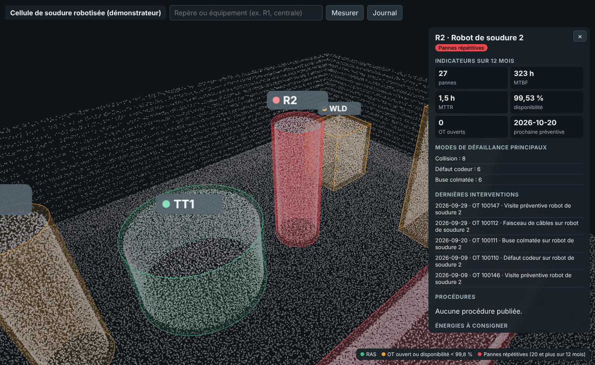
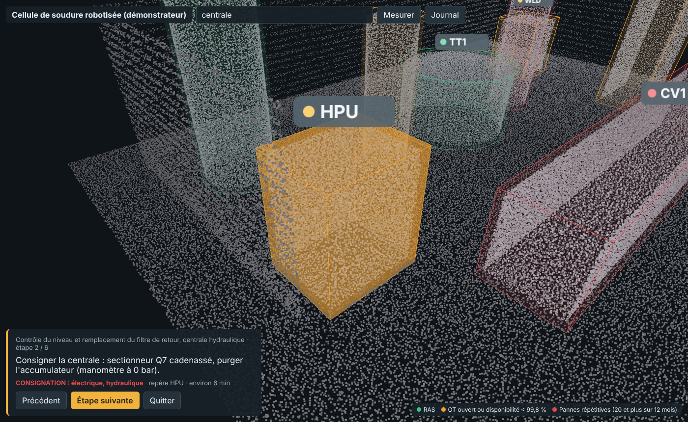

# Maintenance 3D et réalité augmentée sur nuage de points

[](https://github.com/Abderrahmane-BOULAMI/ar-maintenance-viewer/actions/workflows/tests.yml)

Un scan laser d'atelier est une mine d'information pour la maintenance, à condition que les techniciens
puissent s'en servir. Ce projet relie trois sources qui vivent d'habitude séparément (le **nuage de points** de
l'atelier, l'**historique de la GMAO** et les **procédures** de maintenance) dans une vue 3D consultable au
navigateur, en casque de réalité virtuelle ou en maquette de réalité augmentée. Il fournit aussi ce qu'il faut
pour **déployer** l'outil et **mesurer** s'il apporte quelque chose : méthodologie de choix des cas d'usage,
guide utilisateur, formation d'une heure, protocole d'évaluation et modèle de rapport.

Le démonstrateur porte sur une cellule de soudure robotisée **fictive** : le scan, l'historique et les procédures
sont générés ou rédigés pour l'exemple. Chaque brique lit des formats standards (PLY, export CSV de GMAO, YAML)
pour être remplacée par les données d'un vrai site.



## Ce que fait l'outil

| Fonction | Détail |
|---|---|
| Nuage de points | Scan de 574 664 points réduit par voxels de 3 cm à **208 407 points** (3,1 Mo) pour tenir dans le budget d'un terminal mobile ; le budget se règle à la construction |
| État des équipements | 8 équipements colorés selon la GMAO : vert, orange (OT ouvert ou disponibilité sous 99,8 %), rouge (20 pannes ou plus en 12 mois) |
| Fiche équipement | Pannes, MTBF, MTTR, disponibilité, OT ouverts, prochaine préventive, modes de défaillance, 5 dernières interventions, énergies à consigner |
| Procédures pas à pas | 3 procédures, 17 étapes ; la vue se place sur l'équipement de chaque étape, les consignations sont signalées |
| Contrôle des procédures | Publication refusée si une étape travaille sur une énergie non consignée, si un repère est inconnu ou si la durée annoncée ne correspond pas aux étapes |
| Mesure | Distance entre deux points du nuage |
| RV / RA | Boutons WebXR affichés si le terminal les prend en charge : cellule à l'échelle 1 en RV, maquette au 1:10 sur table en RA |
| Journal de session | Export anonyme des équipements consultés, des durées par étape et des mesures, pour l'évaluation |



## Déploiement et évaluation (dossier `docs/`)

- [Méthodologie](docs/methodologie.md) : grille de choix des cas d'usage, préparation des données, choix du
  terminal, conditions de généralisation.
- [Guide utilisateur](docs/guide_utilisateur.md) et [support de formation d'une heure](docs/formation.md).
- [Protocole d'évaluation](docs/protocole_evaluation.md) : temps de localisation, temps de procédure, erreurs,
  score SUS, adoption ; comparaison avec la méthode actuelle et test statistique (`armaint/evaluation.py`).
- [Architecture et prérequis](docs/architecture.md) : matériel, licences, hébergement.
- [Modèle de rapport d'évaluation](docs/rapport_evaluation_modele.md) et [backlog du projet](docs/pilotage/backlog_jira.csv)
  au format d'import Jira.

Le script d'évaluation est testé sur des mesures **fictives** (`evaluation/exemple_rapport.md`) ; aucun essai sur
site n'a été mené.

## Limites

- Les modes RV et RA n'ont pas été testés sur casque : seul le rendu navigateur est vérifié automatiquement.
- En RA, la cellule est une maquette posée sur la table, pas un recalage sur l'installation réelle.
- Les boîtes des équipements sont saisies à la main une fois ; la segmentation automatique du nuage n'est pas traitée.

## Lancer le projet

```bash
pip install -r requirements.txt
python -m armaint.build                    # nuage réduit, indicateurs GMAO, procédures contrôlées
python -m http.server 8000 --directory web # puis ouvrir http://localhost:8000
pytest -q                                  # 12 tests unitaires
python tests/e2e_viewer.py                 # test de bout en bout dans Chromium (Playwright)
```

## Organisation

```
armaint/scene.py        équipements, scan simulé, réduction par voxels, lecture et écriture PLY
armaint/cmms.py         historique GMAO, MTBF, MTTR, disponibilité, état
armaint/procedures.py   chargement et contrôle des procédures
armaint/build.py        génère web/data/cell.ply et web/data/scene.json
armaint/evaluation.py   SUS, comparaison des temps, rapport
web/                    visionneuse three.js et WebXR (aucune installation)
docs/                   méthodologie, guide, formation, protocole, architecture, rapport, backlog
```

Licence MIT. three.js est distribué sous licence MIT (`web/vendor/three/LICENSE`).
